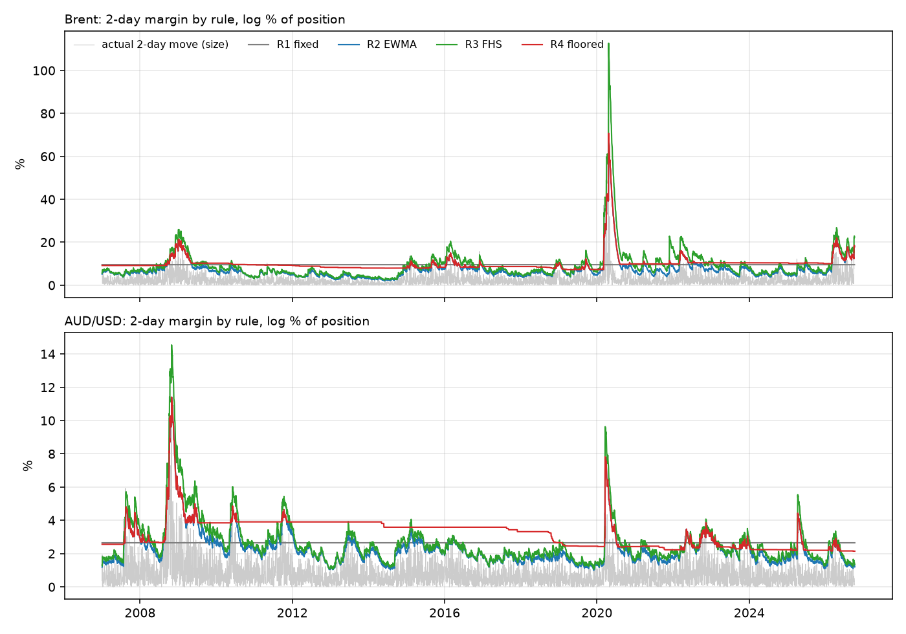

# How much margin does a hedger need? A backtest on Brent and AUD/USD

Independent case study on public data (EIA oil prices, RBA exchange rates), scored from January 2007 to October 2026. Not advice.

Terms used throughout:

- **Initial margin** - the deposit a clearing house holds against a futures position. Here it is set to cover the loss over the next 2 business days with 99% confidence, one side at a time.
- **Breach** - a 2-day move larger than the margin set before it. A good 99% rule breaches about 1% of the time, and not in clusters.
- **Variation margin** - the daily loss on the position, paid in cash every day.
- **Log %** - margins and moves are in log terms; a margin of m covers a price fall of 1 - e^-m (10 log % = 9.5%).

## Summary

**Four margin rules** are tested, each set using only prices up to the close of the day it is set:

| Rule | How it sets margin |
|---|---|
| R1 fixed | One percentage, set from the years before 2007, then held |
| R2 EWMA | 2.33 x exponentially weighted volatility (decay 0.94) x sqrt(2 days) |
| R3 FHS | Filtered historical simulation: today's EWMA volatility x the 1% / 99% quantile of the last 500 daily moves, each divided by the volatility of the day before |
| R4 floored | The larger of R2 and the 1% / 99% 2-day move of the last 10 years. The floor, not EWMA, sets the margin on 82% of days, so R4 is mostly a 10-year historical margin |

**1. Do the rules cover what they claim?** Only 4 of the 16 rule-side combinations pass the conditional-coverage test (right breach rate and no clustering) on both possible sample start days. Breach rates below are over every day's 2-day move; the tests use every 2nd day and are run on both start days.

- **EWMA under-covers falls.** R2 is breached by 2.3% of 2-day Brent falls and 1.9% of AUD/USD falls, against a 1% target; Kupiec rejects 1% on both start days for both. For Brent it holds in every robustness variant (and for WTI), and at 1 and 5 days too (1.9% and 2.7%). Oil and the Australian dollar fall harder than the bell curve behind EWMA assumes.
- **The floored rule over-covers in this sample,** but not robustly. R4 is breached by only 0.5% and 0.3% of AUD/USD moves (long and short). The result fails at decay 0.97, at 99.5%, and in 2007-2009, when R4's breach rate was consistent with 1%.
- **The fixed rule's breaches cluster, but mostly because of 2020.** In the main run R1's breaches cluster on both start days for both series, although its overall rate is close to 1% (Brent 1.1%). 16-19 of Brent R1's breaches fall in 2020, 12-13 of them in or just before the spring 2020 spot dislocation below. Without 2020 it disappears for Brent, and at 99.5%, in either AUD/USD sub-period (2007-2009, 2010 on) and for WTI it shows on only one of the two start days.
- **R3 (FHS) passes most often**: 3 of its 4 rule-sides pass on both start days (the 4th, Brent long, on one).

**2. How much cash does a hedger need in a stress?** Per USD 100 million hedged, under the volatility-based rules R2-R4:

| Hedger | Worst 1 day | Worst 5 days | Worst 20 days (peak) | When |
|---|---|---|---|---|
| Brent airline (long, loses when oil falls) | 28-29m | 45-47m | 64-65m | Feb-Mar 2020 |
| Brent producer (short, loses when oil rises) | 31-33m | 59-61m | 96-106m | 1 and 5 days: Dec 2008; 20 days: from 27 Feb 2026 (Brent $71 to $121 by the peak on 27 Mar) |
| AUD/USD exporter (long AUD) | 10-11m | 19-20m | 28-29m | 1 day: Mar 2020; 5 and 20 days: Oct 2008 |
| AUD/USD importer (short AUD) | 10m | 15m | 16m | 1 and 5 days: Oct 2008; 20 days: Mar 2020 |

- **Margin rises are a large share of short-window bills.** The rise in initial margin is a median 27% of the worst 1-day cash need, 18% of the worst 5-day one and 6% of the worst 20-day one. In March 2026 it added USD 26-35 million to the oil producer's USD 70 million loss; USD 19-30 million of that was the clearing house raising the margin rate, the rest the same rate on a dearer position.
- **The floor changes crisis cash needs little.** Against plain EWMA, R4 changes the worst 20-day cash need in the named crises by USD -3.2 million to +0.1 million. In exchange it ties up more collateral on every day: on average USD 2.5 million more per USD 100 million for the Brent hedgers and USD 0.7 million for the AUD/USD hedgers. That is cash posted, whose cost is the funding spread on it.

## Data

| Series | Source | Used |
|---|---|---|
| Brent spot, USD per barrel | EIA (US Energy Information Administration), daily from May 1987 | Main |
| AUD/USD | RBA table F11, 10 workbooks (1983-2022) and one CSV (2023 on), joined | Main |
| WTI spot, USD per barrel | EIA, daily from 1986 | Robustness only: it went to -36.98 on 20 Apr 2020, so it uses dollar changes |

Checks in `outputs/m1/validation_report.md`: checksums against `data/MANIFEST.csv`; the 11 AUD/USD files join with no overlap; the 31 missing AUD/USD values are 'Closed' or 'N/A' text and stay missing. Brent has only 127-186 prices a year in 1994-1997, so models are scored from 2007, and earlier years only set R1. A move covering more calendar days than an h-day move can (h x 7/5 + 4) spans a hole in the data and is dropped.

**Spring 2020 Brent.** EIA's Brent is the physical "dated" price. From 30 March to May 2020 it came apart from Brent futures as storage filled: -23% on 31 Mar, +35% on 2 Apr, $9.12 on 21 Apr, then a doubling in May. Futures moved far less. The coverage tables also show Brent without moves near 30 Mar - 29 May 2020, and the cost and cash-need results leave those dates out (with them, the oil producer's worst 20 days would be USD 403 million, a spot artefact).

## Method

- **Moves.** Log returns over 1, 2 and 5 business days. 2 days is the headline: the usual minimum margin period for exchange-traded futures.
- **No look-ahead.** The margin set on day t uses prices up to t's close and covers the move from t to t + 2. Tests change every price after a date and check that no earlier margin moves, for Brent and for WTI with changed settings.
- **Breach rates** are over every day's 2-day move, which does not depend on a start day.
- **Coverage tests** on non-overlapping moves (every 2nd day): Kupiec (is the breach rate 1%?), Christoffersen (does a breach make the next more likely?) and both together (conditional coverage). Each test is run on both possible start days, and a verdict counts only if it holds on both.
- **Procyclicality.** The largest rise in margin within 21 business days, and peak over average margin.
- **Hedger cash need.** A position worth USD 100 million on the first day, fixed in barrels or AUD. Cash paid to day d = loss on the position + rise in initial margin (log margin converted to dollars). A window's need is the highest that total reaches inside it.

## Results

### Coverage at 2 days

From `outputs/m2/coverage_report.md`. Breach % = over every day's 2-day move (4,986 Brent and 4,957 AUD/USD). The tests use 2,494 Brent and 2,479 AUD/USD non-overlapping periods per start day, about 25 breaches expected per row.

| Series | Rule | Long breach % | Short breach % | Passes on both start days |
|---|---|---|---|---|
| Brent | R1 fixed | 1.06 | 1.06 | neither (clustered) |
| Brent | R2 EWMA | 2.35 | 1.38 | neither (long: too many; short: depends on start day) |
| Brent | R3 FHS | 1.44 | 1.24 | short only |
| Brent | R4 floored | 0.60 | 0.56 | neither (too few; long borderline) |
| AUD/USD | R1 fixed | 1.35 | 2.18 | neither (clustered; short too many) |
| AUD/USD | R2 EWMA | 1.88 | 0.87 | short only |
| AUD/USD | R3 FHS | 1.19 | 1.23 | both |
| AUD/USD | R4 floored | 0.52 | 0.28 | neither (too few) |



### Cost and procyclicality

| | R1 | R2 | R3 | R4 |
|---|---|---|---|---|
| Brent average margin (log %) | 9.6 | 7.4 | 9.4 | 10.2 |
| Brent largest 1-month rise, outside spring 2020 | - | 4.1x | 4.2x | 3.9x |
| AUD/USD average margin (log %) | 2.7 | 2.3 | 2.6 | 3.3 |
| AUD/USD largest 1-month rise (Mar 2020) | - | 6.1x | 6.7x | 3.2x |

The cheapest rule on average (R2) is also the one that under-covers. The floor (R4) costs the most on average and halves the AUD/USD jump of March 2020, but barely changes Brent's.

### Hedger cash needs

From `outputs/m3/liquidity_report.md`.


### Robustness

From `outputs/m4/robustness_report.md`. Each variant changes one thing.

| Claim | Main | Decay 0.97 | FHS 250 days | 99.5% | Without 2020 | AUD 2007-09 | AUD 2010 on | WTI |
|---|---|---|---|---|---|---|---|---|
| R2 under-covers oil falls | yes | yes | yes | yes | yes | - | - | yes |
| R4 over-covers AUD/USD | yes | **no** | yes | **no** | yes | **no** | yes | - |
| R1 breaches cluster in every series, on both start days | yes | yes | yes | **no** | **no** | **no** | **no** | **no** |
| R4 damps the largest 1-month margin rise | yes | yes | yes | yes | - | - | - | yes |
| Margin rise is a bigger share of 1-day than of 20-day cash needs | yes | yes | yes | yes | yes | - | - | - |
| R4 changes crisis cash need by less than USD 5m | yes | yes | yes | **no** (5.3m) | yes | - | - | - |

## What does not hold up

- **"The fixed rule's breaches cluster"** holds in the main run but not without 2020, at 99.5%, in the AUD/USD sub-periods or for WTI; much of it is the spring 2020 spot dislocation. It is a weak result.
- **"The floor over-covers"** depends on the settings and the period.
- **The USD 5 million bound in the last row is my choice.** At 99.5% the floor saves USD 5.3 million in one crisis. The robust statement is narrower: the floor's crisis saving is a few million per USD 100 million hedged.
- **Coverage verdicts near p = 0.05** flip with the sample start day (Brent R2 short, R3 long, R4 both sides). 16 tests at 2 days with no correction for multiple testing will throw up a false fail or two.

## Limitations

- **Spot is not futures.** Margin is set on futures; spot Brent in spring 2020 shows how far the two can part.
- **Real margin is not recomputed daily.** Clearing houses change margin less often and add buffers and add-ons, so the jumps here are sharper than real ones.
- **Daily data only.** Intraday margin calls, which hit hardest, are not visible.
- **Fixed hedge.** The position is held in barrels or AUD; a real hedger may cut it in a stress.
- **The end of the sample.** Brent jumped 18% on 2 Oct 2026 (the 18th-largest daily move since 1987) and fell 7.4% on 5 Oct; the data end on 6 Oct, so these days cannot be judged.

## How to reproduce

Python 3.11 or later.

```bash
pip install -r requirements.txt
python src/m1_validate.py
python src/m2_coverage.py
python src/m3_liquidity.py
python src/m4_robustness.py
python -m pytest -q
```

The data files are not in the repo. Download them from the URLs in `data/MANIFEST.csv` into `data/raw/`. Each script writes its report and charts to `outputs/mN/`.
