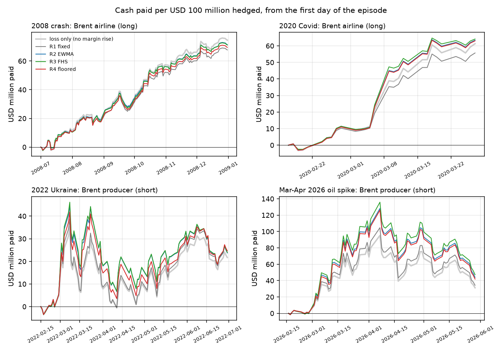

# M3 - hedger liquidity report

Generated by `src/m3_liquidity.py` on 27 Oct 2026. USD million of cash per USD 100 million hedged, windows starting from 01 Jan 2007, margins from M2 at 2 days. A window's cash need is the highest running total of cash paid on any day inside it.

## Answer

Under the volatility-based rules (R2-R4), the worst 20 business days for any hedger cost the Brent producer (short) USD 106 million per USD 100 million hedged at the peak (27 Feb 2026 - 27 Mar 2026, under R3 FHS), of which USD 35 million is higher initial margin (USD 30 million from a higher margin rate, the rest from the same rate on a dearer position). Across hedgers and these rules, the margin rise is a median 27% of the worst 1-day cash need, 18% of the worst 5-day one and 6% of the worst 20-day one: over short windows the margin call is a large share of the bill, over a month the loss on the position dominates. Against plain EWMA (R2), the 10-year floor (R4) changes the worst 20-day cash need in the named crises by USD -3.2 to +0.1 million, small next to the crisis bills, but it ties up on average USD 1.6 million more collateral on every day of the sample (Brent hedgers 2.5m, AUD/USD hedgers 0.7m): cash posted, whose cost is the funding spread on it. Left out: Brent windows touching 30 Mar - 29 May 2020, when spot Brent came apart from futures; there the Brent producer would have needed USD 403 million in 20 days, a spot-price artefact.

## 1. Worst window per hedger (USD million, start date)

Brent windows touching 30 Mar - 29 May 2020 (the spot dislocation, see `data.SPOT_EVENT`) are left out here and in sections 2-3.

### 1 business day

| series | hedger | R1 fixed | R2 EWMA | R3 FHS | R4 floored |
|---|---|---|---|---|---|
| Brent | airline | 20.5 (06 Mar 2020) | 27.6 (06 Mar 2020) | 29.2 (06 Mar 2020) | 27.6 (06 Mar 2020) |
| Brent | producer | 21.9 (31 Dec 2008) | 31.0 (31 Dec 2008) | 32.5 (31 Dec 2008) | 31.0 (31 Dec 2008) |
| AUD/USD | exporter | 7.3 (03 Oct 2008) | 10.5 (18 Mar 2020) | 11.2 (18 Mar 2020) | 10.5 (18 Mar 2020) |
| AUD/USD | importer | 7.6 (29 Oct 2008) | 9.7 (29 Oct 2008) | 9.7 (29 Oct 2008) | 9.7 (29 Oct 2008) |

### 5 business days

| series | hedger | R1 fixed | R2 EWMA | R3 FHS | R4 floored |
|---|---|---|---|---|---|
| Brent | airline | 35.9 (05 Mar 2020) | 45.0 (05 Mar 2020) | 47.0 (05 Mar 2020) | 45.0 (05 Mar 2020) |
| Brent | producer | 47.4 (29 Dec 2008) | 58.9 (29 Dec 2008) | 60.9 (29 Dec 2008) | 58.9 (29 Dec 2008) |
| AUD/USD | exporter | 16.7 (02 Oct 2008) | 18.9 (02 Oct 2008) | 19.5 (02 Oct 2008) | 18.9 (02 Oct 2008) |
| AUD/USD | importer | 12.1 (28 Oct 2008) | 15.0 (28 Oct 2008) | 14.9 (28 Oct 2008) | 15.0 (28 Oct 2008) |

### 20 business days

| series | hedger | R1 fixed | R2 EWMA | R3 FHS | R4 floored |
|---|---|---|---|---|---|
| Brent | airline | 56.2 (19 Feb 2020) | 64.4 (20 Feb 2020) | 65.3 (20 Feb 2020) | 64.3 (19 Feb 2020) |
| Brent | producer | 77.3 (27 Feb 2026) | 99.1 (27 Feb 2026) | 105.8 (27 Feb 2026) | 96.0 (27 Feb 2026) |
| AUD/USD | exporter | 25.4 (29 Sep 2008) | 27.9 (29 Sep 2008) | 28.5 (29 Sep 2008) | 27.9 (29 Sep 2008) |
| AUD/USD | importer | 15.5 (19 Mar 2020) | 15.7 (19 Mar 2020) | 15.7 (19 Mar 2020) | 15.7 (19 Mar 2020) |

## 2. The worst 20 days split into loss and margin rise, on the peak day

A negative 'margin up' means margin had fallen by the peak day, giving cash back. 'of which rate up' is the part due to a higher margin rate; the rest is the same rate on a position whose value moved. R1's rate never changes, so its margin moves only with the price.

| series | hedger | rule | need $m | loss $m | margin up $m | of which rate up $m | start | peak day |
|---|---|---|---|---|---|---|---|---|
| Brent | airline | R1 fixed | 56.2 | 61.8 | -5.6 | 0.0 | 19 Feb 2020 | 18 Mar 2020 |
| Brent | airline | R2 EWMA | 64.4 | 61.7 | 2.7 | 6.9 | 20 Feb 2020 | 18 Mar 2020 |
| Brent | airline | R3 FHS | 65.3 | 61.7 | 3.5 | 9.3 | 20 Feb 2020 | 18 Mar 2020 |
| Brent | airline | R4 floored | 64.3 | 61.8 | 2.4 | 6.8 | 19 Feb 2020 | 18 Mar 2020 |
| Brent | producer | R1 fixed | 77.3 | 70.3 | 7.0 | 0.0 | 27 Feb 2026 | 27 Mar 2026 |
| Brent | producer | R2 EWMA | 99.1 | 70.3 | 28.8 | 24.3 | 27 Feb 2026 | 27 Mar 2026 |
| Brent | producer | R3 FHS | 105.8 | 70.3 | 35.4 | 30.5 | 27 Feb 2026 | 27 Mar 2026 |
| Brent | producer | R4 floored | 96.0 | 70.3 | 25.7 | 19.1 | 27 Feb 2026 | 27 Mar 2026 |
| AUD/USD | exporter | R1 fixed | 25.4 | 26.1 | -0.7 | 0.0 | 29 Sep 2008 | 28 Oct 2008 |
| AUD/USD | exporter | R2 EWMA | 27.9 | 26.1 | 1.8 | 3.2 | 29 Sep 2008 | 28 Oct 2008 |
| AUD/USD | exporter | R3 FHS | 28.5 | 26.1 | 2.4 | 4.1 | 29 Sep 2008 | 28 Oct 2008 |
| AUD/USD | exporter | R4 floored | 27.9 | 26.1 | 1.8 | 3.2 | 29 Sep 2008 | 28 Oct 2008 |
| AUD/USD | importer | R1 fixed | 15.5 | 15.2 | 0.3 | 0.0 | 19 Mar 2020 | 14 Apr 2020 |
| AUD/USD | importer | R2 EWMA | 15.7 | 15.2 | 0.5 | -0.6 | 19 Mar 2020 | 14 Apr 2020 |
| AUD/USD | importer | R3 FHS | 15.7 | 15.2 | 0.5 | -0.6 | 19 Mar 2020 | 14 Apr 2020 |
| AUD/USD | importer | R4 floored | 15.7 | 15.2 | 0.5 | -0.6 | 19 Mar 2020 | 14 Apr 2020 |

## 3. Named crises: worst 20-day cash need starting inside each (USD million)

| episode | series | hedger | R1 fixed | R2 EWMA | R3 FHS | R4 floored |
|---|---|---|---|---|---|---|
| 2008 crash | Brent | airline | 36.3 | 38.3 | 39.2 | 38.3 |
| 2008 crash | Brent | producer | 49.4 | 60.6 | 62.6 | 60.6 |
| 2008 crash | AUD/USD | exporter | 25.4 | 27.9 | 28.5 | 27.9 |
| 2008 crash | AUD/USD | importer | 14.2 | 15.0 | 15.0 | 15.0 |
| 2014-16 oil glut | Brent | airline | 27.4 | 29.1 | 28.8 | 28.7 |
| 2014-16 oil glut | Brent | producer | 43.6 | 47.0 | 48.3 | 47.0 |
| 2014-16 oil glut | AUD/USD | exporter | 7.0 | 7.9 | 8.0 | 6.9 |
| 2014-16 oil glut | AUD/USD | importer | 7.7 | 8.2 | 8.2 | 7.9 |
| 2020 Covid | Brent | airline | 56.2 | 64.4 | 65.3 | 64.3 |
| 2020 Covid | Brent | producer | 4.5 | 5.1 | 5.1 | 4.6 |
| 2020 Covid | AUD/USD | exporter | 15.8 | 20.5 | 21.6 | 19.5 |
| 2020 Covid | AUD/USD | importer | 15.5 | 15.7 | 15.7 | 15.7 |
| 2022 Ukraine | Brent | airline | 21.1 | 21.3 | 21.8 | 21.3 |
| 2022 Ukraine | Brent | producer | 43.7 | 50.1 | 51.4 | 46.9 |
| 2022 Ukraine | AUD/USD | exporter | 7.4 | 8.4 | 8.4 | 8.4 |
| 2022 Ukraine | AUD/USD | importer | 6.1 | 6.2 | 6.2 | 6.2 |
| Mar-Apr 2026 oil spike | Brent | airline | 28.2 | 25.7 | 25.5 | 25.7 |
| Mar-Apr 2026 oil spike | Brent | producer | 77.3 | 99.1 | 105.8 | 96.0 |
| Mar-Apr 2026 oil spike | AUD/USD | exporter | 4.6 | 4.6 | 4.5 | 4.6 |
| Mar-Apr 2026 oil spike | AUD/USD | importer | 5.2 | 5.4 | 5.4 | 5.4 |
| Sep-Oct 2026 | Brent | airline | -1.4 | -1.7 | -1.7 | -1.7 |
| Sep-Oct 2026 | Brent | producer | 39.8 | 45.4 | 49.2 | 45.4 |
| Sep-Oct 2026 | AUD/USD | exporter | 4.0 | 4.1 | 4.5 | 4.0 |
| Sep-Oct 2026 | AUD/USD | importer | 1.3 | 1.2 | 1.2 | 1.3 |

## 4. Collateral held (USD million on a USD 100 million position, average of every day since 2007)

What each rule ties up with the clearing house. It is a stock of cash, not a cost: its cost is the funding spread on it.

| series | hedger | R1 fixed | R2 EWMA | R3 FHS | R4 floored |
|---|---|---|---|---|---|
| Brent | airline | 9.1 | 7.0 | 8.6 | 9.5 |
| Brent | producer | 10.0 | 7.9 | 8.3 | 10.5 |
| AUD/USD | exporter | 2.6 | 2.3 | 2.6 | 3.2 |
| AUD/USD | importer | 2.1 | 2.3 | 2.3 | 2.9 |

## Limitations

- Spot prices stand in for futures. The spring 2020 Brent dislocation is left out, not modelled, and the EWMA volatility still carries it into June 2020.
- The position is fixed in barrels (or AUD) from the first day; a real hedger may cut the position.
- Margin is the M2 rule, recomputed daily; real clearing houses change margin less often and add buffers.
- Worst windows are picked by total cash need, so the shares by window length compare different dates; they say how big the margin part of the worst bill is, not when in a crisis it arrives.
- The Brent data end on 6 Oct 2026, so 'Sep-Oct 2026' windows mostly lie in September; the jump of 2 Oct (+18%) and the fall of 5 Oct (-7.4%) show only in the 1-day and 5-day windows.
